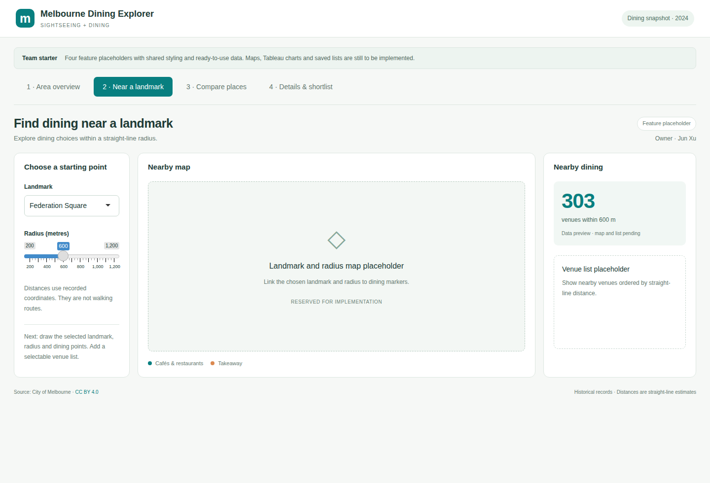

# Melbourne Dining Explorer

Melbourne Dining Explorer is an R Shiny prototype for exploring dining options across Melbourne areas and around landmarks. It uses City of Melbourne open data and includes four modules: area overview, nearby dining, landmark comparison, and venue details with a shortlist.

The current version provides page layouts and shared components. Area and landmark catchment counts use the supplied data. Maps and venue lists are placeholders; Tableau charts and shortlist interactions have not been implemented.



## Feature status

| Module | Implemented | Planned |
|---|---|---|
| Area overview | Area selection and venue counts for the selected area | Area map and Tableau overview chart |
| Nearby dining | Landmark and radius selection, with venue counts within the radius | Map, nearby venue list, and venue selection |
| Landmark comparison | Counts within the same radius and the number of shared venues | Comparison map and category charts |
| Venue details and shortlist | Page layout and an empty shortlist state | Venue details, save and remove actions, and CSV export |

Placeholder regions are labelled in the interface. Save and export buttons remain disabled until their interactions are implemented.

## Requirements

The application requires R and the `shiny` and `jsonlite` packages. A web browser is required to access the Shiny interface.

The current version has been checked on Ubuntu WSL with R 4.3.3, shiny 1.14.0, and jsonlite 2.0.0. Minimum supported versions have not been established.

The application reads the data snapshot included in the repository. No data download or cleaning step is needed before startup. Shiny interactions require a running R process; GitHub Pages cannot run this application directly.

## Getting started

Clone the repository and enter its root directory:

```bash
git clone https://github.com/scdxwyxj-ops/iv-a3-melbourne-dining-demo.git
cd iv-a3-melbourne-dining-demo
```

Before the first run, install the dependencies in an R console:

```r
install.packages(c("shiny", "jsonlite"))
```

Set the R working directory to the repository root, then start the application:

```r
shiny::runApp(".", host = "127.0.0.1", port = 3876, launch.browser = TRUE)
```

Alternatively, start it from a terminal:

```bash
Rscript -e 'shiny::runApp(".", host="127.0.0.1", port=3876, launch.browser=FALSE)'
```

Open [http://localhost:3876](http://localhost:3876). If port 3876 is already in use, change `port` in the command and open the corresponding address.

If startup reports a missing package, install that package in the R console. If it reports missing files, check that the working directory contains `app.R` and `data/`.

## Data

| File | Contents |
|---|---|
| `data/venues.csv` | A 2024 dining census snapshot with 1,994 venues, one venue per row |
| `data/landmarks.csv` | 242 place-of-interest records, including tourism and non-tourism facilities |
| `data/clue_areas.geojson` | The City of Melbourne's 13 CLUE statistical areas |

The dining table combines indoor and outdoor seating records for each venue. Missing seat counts represent unknown values, and multiple venues may share coordinates. Catchments use straight-line distance. The data does not provide live opening status or walking routes. See the [data documentation](data/README.md) for fields and processing rules.

## Repository structure

```text
app.R                       Application entry point and page assembly
R/core/                     Data loading, distances, session state, and shared components
R/modules/area/             Area overview module
R/modules/nearby/           Nearby dining module
R/modules/compare/          Landmark comparison module
R/modules/shortlist/        Venue details and shortlist module
www/css/common.css          Shared colours and layout
www/css/                    Module-specific styles
data/                       Data snapshot, sources, and file checksums
tableau/                    Tableau workbook directory and integration notes
docs/                       Architecture, design guidelines, and collaboration documents
```

Each feature directory contains `ui.R` and `server.R`. Shiny modules isolate their inputs and outputs. Shared data rules and components are provided by `R/core/`.

## Development documentation

- [Module structure and interfaces](docs/ARCHITECTURE.md)
- [Shared design language](docs/DESIGN_LANGUAGE.md)
- [Module responsibilities and course deliverables](docs/TEAM_ASSIGNMENTS.md)
- [Tableau integration](tableau/README.md)
- [AI use statement](docs/STARTER_AI_USAGE.md)

## Support

Report runtime problems and feature suggestions through [GitHub Issues](https://github.com/scdxwyxj-ops/iv-a3-melbourne-dining-demo/issues). Include steps to reproduce the problem, error messages, and the versions of R and the relevant packages.

## Project context and licensing

This project is part of Assignment 3 for GEOM90007 Information Visualisation at the University of Melbourne, Group 26. The final application must incorporate at least one Tableau visualisation within R Shiny. That integration is not yet implemented.

The data is published by the City of Melbourne under [CC BY 4.0](https://creativecommons.org/licenses/by/4.0/). Attribution and transformations are documented in the [data documentation](data/README.md). No licence has been specified for the application code or documentation; the data licence does not apply to the repository's code as a whole.
